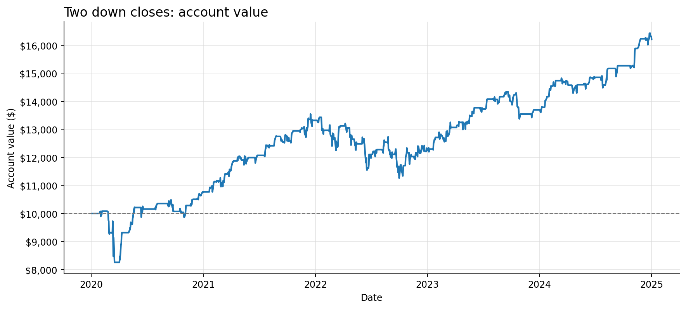
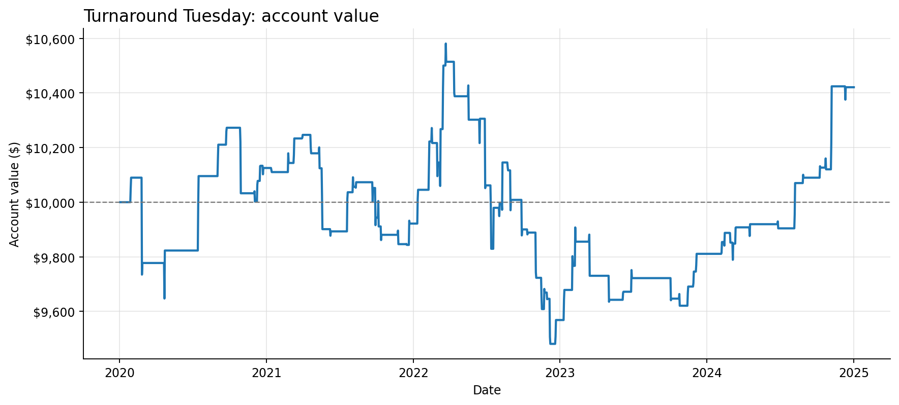

# Real Reddit case studies

[View the combined 2020–2024 report](../examples/reports/2020-2024/index.html) and its [frozen research-window record](../configs/research-window-2020-2024.json).

These examples test whether the installed Codex model can translate different post rules into strategy-only Python while the host controls orders, cash, fills and reporting. They are retrospective software and research checks, not evidence of a trading edge. Both selected posts were written after the 2020–2024 price sample and are from the same author, so the examples are not independent validation of a discovery process.

The exact publication timestamp of the Tuesday post is not retained in the accessible page; its source import uses `publication_precision: unknown`. A stale relative-age label initially led to an overprecise month in a local first attempt. That attempt remains in the ignored trial registry. The public example was regenerated after correcting this metadata, without changing the source rule or choosing a strategy based on its return.

| Source and chosen variant | Source rule preserved | Real-data outcome | Public artifacts |
| --- | --- | --- | --- |
| [Two down closes, five held sessions](https://www.reddit.com/r/StockTradingIdeas/comments/1x8o01e/buying_spy_after_two_red_days_in_a_row_made_283/) | SPY close falls on two consecutive days; buy next open; hold five sessions | 105 filled buys, 104 filled sells, 8 rejected buys; 2020–2024 net price return +62.03% under our declared costs | [Code, config and charts](../examples/reports/post-1x8o01e/report.md) |
| [Red Monday, Tuesday to Wednesday](https://www.reddit.com/r/TheRaceTo10Million/comments/1wmxzw7/turnaround_tuesday_on_spy_is_real_and_it_still/) | Monday close below the previous Friday; buy Tuesday open and sell Wednesday open | 79 completed round trips, 6 rejected buys; 2020–2024 net price return +4.21% under our declared costs | [Code, config and charts](../examples/reports/post-1wmxzw7/report.md) |

Both simulations used **1,258 observed daily SPY bars** from January 2, 2020 through December 31, 2024, a $10,000 initial cash account, whole shares, 2 basis points fee and 3 basis points adverse slippage per fill. The source posts say costs were charged but do not disclose the same exact schedule or sizing policy. We chose those parameters before running each case and mark the result `llm_hypothesis`. The first post reports three different exits; we selected its five-session variant without testing the other two here. We count the entry session as the first held session. A rejected buy is **not** resized or counted as a trade; overnight gaps caused the rejected orders. The first run ends with 27 SPY shares still held and marked at the final close, not sold at a fabricated closing fill.

For both generated strategies, an independent Codex call checked the source and worker interface before the first performance run. I then checked **every order** against the actual price CSV, independently of the strategy code: each signal-to-fill interval was one observed bar; buy signals had the required two down closes or red Monday; every filled five-session sell occurred after five held sessions; every filled calendar exit occurred on Wednesday's open; and all executed prices and fees matched the host's formula. The runner also replayed the first half of each actual dataset in a fresh worker and matched the decisions. These checks establish the recorded trade timing and arithmetic for this sample, not complete semantic proof or freedom from selection bias.





The Tuesday case caught an interface problem before a backtest: the first generated candidate could not know whether both named weekdays were exchange sessions, and it refused to trade. The host now passes the **next two scheduled XNYS session dates**, without future market prices, so code can skip a holiday week. A historical calendar can include extraordinary closures only known after the fact; this sample's qualifying trades were checked to use ordinary Tuesday and Wednesday opens. Future research requiring strict as-of-time holiday knowledge needs a versioned, point-in-time calendar.

Other real posts were reviewed but not forced into this engine. The [lower-low/lower-high reversal post](https://www.reddit.com/r/algotrading/comments/1f8v70e/backtest_results_for_a_simple_reversal_strategy/) requires a buy-stop trigger and same-day close exit. The previously requested [EUR/USD ATR post](https://www.reddit.com/r/algotrading/comments/1v53mep/what_do_u_think_about_my_strategy/) requires FX, simultaneous pending stops and bracket exits; its [fidelity audit](post-1v53mep.md) records why no stock backtest was run. The [multi-fund SMA post](https://www.reddit.com/r/TQQQ/comments/1uyvm6k/crazy_sma_strategy_with_786_cagr/) describes several interacting exits and gradual allocations without enough precedence and sizing detail for an exact replication; its author explicitly calls the strategy overfit. These exclusions are preferable to replacing their mechanisms with generic indicator trades.

## Reproduce the examples locally

Use the reviewed public code and configuration; no model call is needed for replaying their decisions. Download **real** SPY bars with the exact required period and inspect the provider sidecar. The exported price hash for both examples is `0311e24a54fc387484e0b3adb616ecc00499eda43ef0d977b3ddc68cff59ecff`. A vendor revision may produce a different hash and different numbers; the project does not distribute market bars or substitute synthetic observations.

```sh
python3 -m uv sync --locked
python3 -m uv run rsl fetch-prices --start 2020-01-01 --end 2025-01-01
python3 -m uv run rsl check-code-sandbox
python3 -m uv run rsl run-code examples/reports/post-1x8o01e/strategy.py \
  --config examples/reports/post-1x8o01e/config.json \
  --prices data/market/SPY-2020-01-01-2025-01-01.csv
python3 -m uv run rsl run-code examples/reports/post-1wmxzw7/strategy.py \
  --config examples/reports/post-1wmxzw7/config.json \
  --prices data/market/SPY-2020-01-01-2025-01-01.csv
```

To regenerate strategy code with a signed-in local Codex CLI, first create your own lawful source import with the post provenance. The private `data/posts/*.json` inputs used for these examples are intentionally excluded from Git. `rsl generate-code` accepts that import, the matching public config, `--hypotheses`, and an optional real `--prices` file. Its independent review and any repair happen before the host receives prices or calculates performance.

After each `run-code` command prints its run directory, repeat the independent trade checks with the corresponding case name:

```sh
python3 scripts/verify_case_orders.py two-down runs/custom-code/RUN_ID \
  data/market/SPY-2020-01-01-2025-01-01.csv
python3 scripts/verify_case_orders.py turnaround-tuesday runs/custom-code/OTHER_RUN_ID \
  data/market/SPY-2020-01-01-2025-01-01.csv
```
