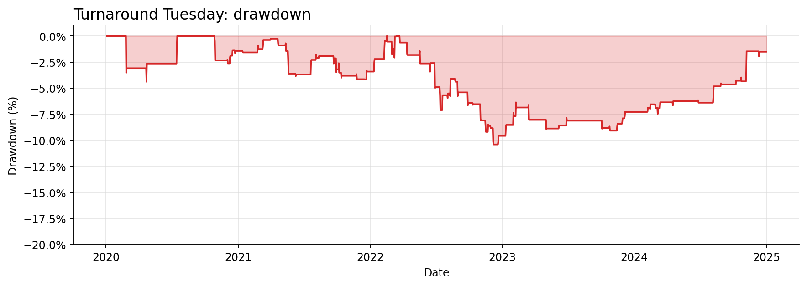

# SPY red Monday: Tuesday to Wednesday

Source: [original Reddit post](https://www.reddit.com/r/TheRaceTo10Million/comments/1wmxzw7/turnaround_tuesday_on_spy_is_real_and_it_still/). This is a **source-inspired interpretation** with disclosed assumptions; it is not the author's original trade record or a claim of a tradable edge.

Codex model: `gpt-6.1-sol`. Independent model review: passed. Host's fresh-worker causal prefix replay: passed. [Human trade-level checks](../../../docs/case-studies.md) compared every recorded order with the real price bars. The model received source text and interface rules, but no market prices or performance feedback before code was frozen.

| Measure | Result |
| --- | ---: |
| Real price observations | 1,258 |
| Sample | 2020-01-02 to 2024-12-31 |
| Initial capital | $10,000.00 |
| Final marked equity | $10,420.91 |
| Total price return after configured costs | 4.21% |
| Maximum bar-close drawdown | -10.39% |
| Filled orders | 158 |
| Rejected orders | 6 |
| Expired orders | 0 |
| Final open shares | SPY: 0 |

The sample predates this post. It is retrospective and was **not** an untouched holdout. The public charts are static exports; raw provider prices, full source body, model transcripts, and the complete order ledger remain local.

Code SHA256: `9a5afebeef7b2c98c81a7249c9d5230607c1879ffab3ba212afbc89ab708cea4`. Real market CSV SHA256: `0311e24a54fc387484e0b3adb616ecc00499eda43ef0d977b3ddc68cff59ecff`. Price source: Yahoo Finance chart endpoint; real observed OHLCV, personal research. cash dividends excluded; Yahoo unadjusted OHLC price returns, not Adj Close total returns. Fills use the next observed market open with configured slippage and fees; cash, positions and caps are enforced by the host.

## Declared assumptions

- A red Monday means Monday's close is below the preceding Friday's close; require both observed calendar sessions.
- Buy Tuesday open and sell Wednesday open. If a named session is a market holiday, skip that week's setup rather than shifting the weekday rule.
- Use the host's whole-share cash account, 2 bps fee and 3 bps slippage per fill; the post does not disclose the exact cost schedule or sizing rules.
- 2020-2024 data predates the 2026 post and is retrospective only; it is not an untouched holdout.
- Use completed daily SPY bars, with one strategy instance owning the SPY position and a unique command-ID namespace within its run.
- Require an observed Friday session exactly three calendar days before Monday; skip setups when Tuesday or Wednesday is not a scheduled session.
- Use fraction=1 by default, allocating up to that fraction of current equity subject to available cash and whole-share rounding.
- The host enforces the configured 100% position and total caps and applies 2 bps fees and 3 bps slippage per fill. Close-based sizing cannot guarantee affordability at the unknown next open.
- The account starts without unrelated positions or orders. Daily callbacks and next recorded opens follow the supplied exchange calendar.
- The supplied 2020–2024 data is retrospective relative to the 2026 post and is not an untouched holdout.

## Engine limits

- cash long-only equities; fixed universe; no stops/shorts/FX
- whole-order fills assume liquidity; no volume/queue/market-impact reconstruction
- split-adjusted price returns; dividends excluded
- caps apply at buys; subsequent market drift may exceed them
- prefix agreement is a regression check, not proof against all leakage/overfitting

[Exact reviewed strategy code](strategy.py) · [Frozen configuration](config.json)

