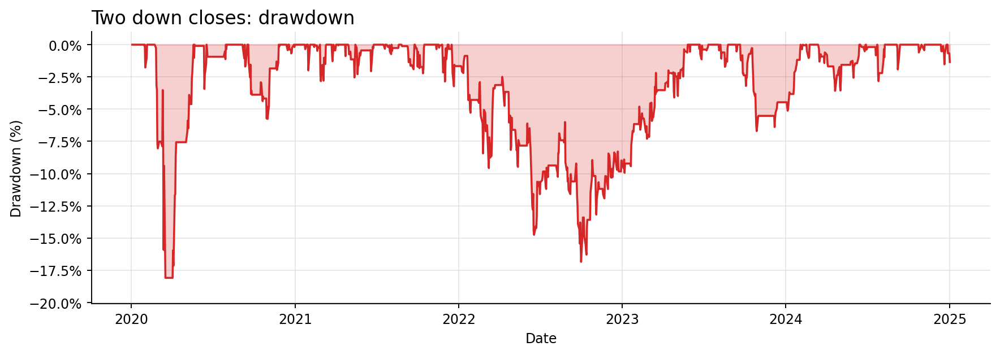

# SPY after two down closes: five held sessions

Source: [original Reddit post](https://www.reddit.com/r/StockTradingIdeas/comments/1x8o01e/buying_spy_after_two_red_days_in_a_row_made_283/). This is a **source-inspired interpretation** with disclosed assumptions; it is not the author's original trade record or a claim of a tradable edge.

Codex model: `gpt-6.1-sol`. Independent model review: passed. Host's fresh-worker causal prefix replay: passed. [Human trade-level checks](../../../docs/case-studies.md) compared every recorded order with the real price bars. The model received source text and interface rules, but no market prices or performance feedback before code was frozen.

| Measure | Result |
| --- | ---: |
| Real price observations | 1,258 |
| Sample | 2020-01-02 to 2024-12-31 |
| Initial capital | $10,000.00 |
| Final marked equity | $16,202.62 |
| Total price return after configured costs | 62.03% |
| Maximum bar-close drawdown | -18.08% |
| Filled orders | 209 |
| Rejected orders | 8 |
| Expired orders | 0 |
| Final open shares | SPY: 27 |

The sample predates this post. It is retrospective and was **not** an untouched holdout. The public charts are static exports; raw provider prices, full source body, model transcripts, and the complete order ledger remain local.

Code SHA256: `95a2127d68b0977cb415971172c0a94fff17aaebc4182b2ab71bf4b8e17ccf63`. Real market CSV SHA256: `0311e24a54fc387484e0b3adb616ecc00499eda43ef0d977b3ddc68cff59ecff`. Price source: Yahoo Finance chart endpoint; real observed OHLCV, personal research. cash dividends excluded; Yahoo unadjusted OHLC price returns, not Adj Close total returns. Fills use the next observed market open with configured slippage and fees; cash, positions and caps are enforced by the host.

## Declared assumptions

- Use the post's five-session exit variant; the other two exit variants are separate experiments and are not optimized here.
- Two down closes means two consecutive close-to-close declines, not two red candle bodies.
- Count the entry session as session one; exit at the next open after five completed held sessions.
- Use the host's whole-share cash account, 2 bps fee and 3 bps slippage per fill; the post does not state its exact cost schedule or sizing rules.
- 2020-2024 data predates the October 2026 post and is retrospective only; it is not an untouched holdout.
- Use SPY daily completed-session bars and the five-session exit variant; Wednesday and weekend exits are separate experiments.
- Two down closes means consecutive close-to-close declines; unchanged or higher closes reset the streak.
- Count the entry session as session one and sell at the next recorded open after five completed held sessions, using next_bar validity across session boundaries.
- Default hold_sessions is 5 and fraction is 1; supplied parameters may override those values within their validated ranges.
- Allocate up to fraction of current equity, limited by available cash, with whole-share sizing estimated from the signal close and configured 2 bps fees and 3 bps slippage.
- Use the configured 100% position and total exposure caps; the host enforces actual fill affordability and caps.
- Run as the sole strategy in the configured SPY-only account, initially flat, with one Strategy instance per run so command identifiers remain unique.
- Ignore additional entry signals while holding; after an exit fills, a qualifying signal at that session's close may initiate a new trade.
- Count recorded trading sessions rather than calendar days; holidays do not add holding sessions.
- The cited 2020–2024 evaluation period is retrospective, not an untouched holdout; no dates or historical outcomes are encoded.

## Engine limits

- cash long-only equities; fixed universe; no stops/shorts/FX
- whole-order fills assume liquidity; no volume/queue/market-impact reconstruction
- split-adjusted price returns; dividends excluded
- caps apply at buys; subsequent market drift may exceed them
- prefix agreement is a regression check, not proof against all leakage/overfitting

[Exact reviewed strategy code](strategy.py) · [Frozen configuration](config.json)

