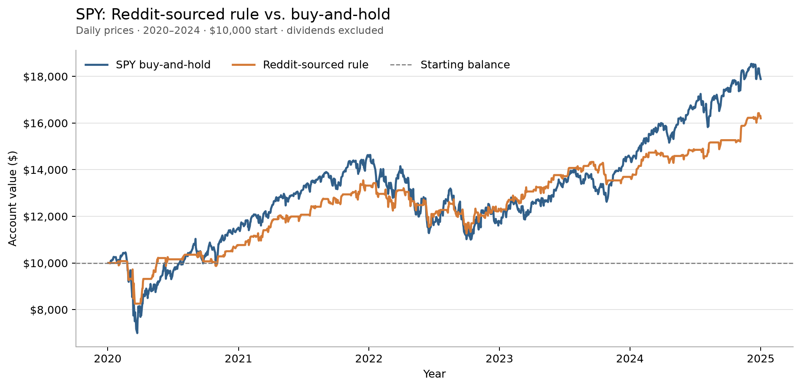
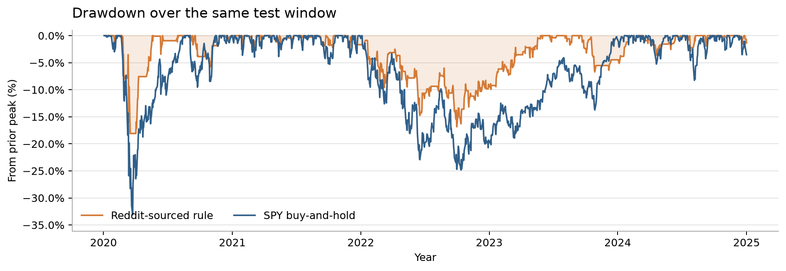

# i built a bot that makes reddit trading strategies show their work

*it searches selected subreddits, turns posts into backtests, and tells me when a strategy is too vague to test. the goal is to do research, not larp as a quant because a line went up.*

## the idea

there’s always someone on a trading subreddit posting a chart with a caption like “this setup prints.” the replies are already split between “genius” and “this is overfit.”

i wanted a way to check the idea without copying the post into a notebook, guessing what the rules mean, then writing a new backtester every time. and i don’t want a bot that spits out a green chart so i can larp as a quant for an afternoon. i want to see the post, the rules it pulled from it, the code, and what happened when those rules hit the backtester.

the main reason i built it is i don’t have all the time in the world. i’ve got school, homework, other projects, and i still want to test more than one idea every few weeks. so the system can search a batch of posts, turn the ones with enough detail into rules, run the backtests, and leave the reports for me to review. i can spend my time checking what it did instead of manually feeding every post through the same steps.

i’m Vihaan, a high-school freshman trying to make $1 million trading before i graduate. i have about $900 in my account, so yeah, it’s a pretty ambitious goal. this project is one attempt to get better at the research part. it doesn’t place live trades. it searches Reddit strategy posts, tries to turn them into rules, and sends those rules through a backtest. if a post leaves out something important, the system should say so instead of making up a rule and calling it alpha.

the flow has two possible endings:

`enough detail → rule sheet → Python strategy → backtest → report`

`missing detail → flag the gap → no made-up backtest`

that second path is the feature i care about most. “i can’t test this yet” is a much better answer than a clean-looking result based on a guess.

i put the code, configs and run files here so you can check what it did: [open the project files](https://github.com/V-Juneja/reddit-strategy-lab).

## 1. finding posts without reading all of reddit

the scanner checks selected subreddits through Reddit’s OAuth access. it looks at new, hot and top posts, plus searches for words like momentum, volatility, entries and exits. each run has a request limit, and it rotates which feed it checks first so one busy subreddit doesn’t eat the whole budget. if access is missing, it stops. no sneaky anonymous scraping.

for each post, it saves where it found it, when it found it, and a hash of the text. if the same post shows up in a few feeds, it gets marked as a duplicate. saved cursors let the next run pick up where the last one stopped.

there’s a collect-only mode too. it saves the posts and search log without asking a model to read them or running a backtest. that lets me see what the scanner found before the more expensive steps start.

this is a bounded scan of selected feeds, not every Reddit post ever made. it reads the post, not its comments or linked articles. so if the actual entry rule is hiding in a comment, the scanner misses it. when a post doesn’t give enough detail, the result should be “needs clarification” or “unsupported,” not a confident chart based on rules nobody wrote.

## 2. turning “buy the dip” into actual rules

posts are written for people, not code. “buy the dip and sell when it turns around” sounds like a strategy until you ask what counts as a dip.

before it writes anything, the system checks what the post says about:

- the symbol or group of symbols
- the timeframe
- entry and exit rules
- position size
- when an order could fill
- what’s missing or ambiguous

a language model turns the post into a rule sheet, with short quotes showing where each rule came from. the system checks that sheet against a fixed schema and the data config. if the post leaves out a required detail, faithful mode stops. if the backtester doesn’t support the market or order type, it records that instead of swapping in SPY just to get a chart.

there’s also a hypothesis mode for testing an interpretation. any guess has to be written down with the result, so nobody mistakes my interpretation for what the Reddit author actually said.

“two red days” is a good example. does that mean two candles that closed below their open, or two closes lower than the day before? those are different rules. if the code quietly picks one, the test might answer a question the post never asked. and that’s where i could start larping as a quant: let the model guess, then act like the result came straight from the post.

## 3. getting the code to follow the post

once a post has enough detail, the coding model gets the post, its rule sheet, and a small interface that tells it what the strategy can do. it writes a Python strategy from those rules. it doesn’t see the historical prices or backtest results while writing, so it can’t tune the code to a curve it already saw.

i use the Codex CLI i’m already signed into. i was not about to spend a pile of money on model credits just to find out “buy the dip” doesn’t compile. the repo doesn’t store a model API key.

the generated code can look at completed bars and the simulated account’s cash and positions. it can ask to place an order, but it can’t decide the order filled, pick its own price, or edit the account balance. a separate check compares the code to the rule sheet and checks that it uses the interface properly. if it finds a specific problem, the model gets one try to fix it. if that still fails, there’s no result to publish.

and a clean-looking Python file doesn’t prove the model understood the post. that’s why the report keeps the source post, rule sheet, assumptions, code and review result together. you can follow what the system read and what it tested.

## 4. the backtester handles the money part

the strategy can ask for an order. the backtest engine handles prices, fills and the account.

it needs actual price files for the exact symbol and timeframe in the config. it checks for missing or misaligned bars instead of filling gaps with made-up prices or quietly switching tickers. the strategy only sees completed bars, so a signal at today’s close can first trade at tomorrow’s open.

the engine checks each order against cash and position limits. it handles whole shares, fees and slippage, rejects buys the account can’t afford, and rejects sells that would create a short position. no leverage, no brokerage connection, and no magic fill at the same close that triggered the signal.

the generated code also runs in a restricted macOS sandbox. it can’t read project files or credentials, use the network, or launch another process. it gets a limited snapshot of the market and account, then returns typed order requests. if the sandbox check fails, the run stops.

## 5. one post goes through the pipeline

every candidate gets a status: ran, needs more detail, unsupported, or skipped. if it runs, the report saves the original post, extracted rules, code, settings, orders and charts together. a green line by itself doesn’t tell you what the system thought it was testing.

one post the scanner found described buying SPY after two consecutive lower closes and holding for five sessions. the system turned that into rules and ran it through the same engine. the test used daily SPY prices from Yahoo Finance from 2020 to 2024, a simulated $10,000 account, next-open fills, whole shares, 2 basis points in fees and 3 basis points of slippage per fill. dividends are excluded.

the rule finished around $16,203, up 62%. that’s the part that looks great in a screenshot. then i ran SPY buy-and-hold over the same period with the same starting cash and costs: about $17,887, up 79%. so, yeah, i got beat by buying the thing and doing nothing.

*me seeing +62% before scrolling down to the SPY line:*

[GIF via Tenor](https://tenor.com/view/martin-scorsese-absolute-cinema-absolute-cinema-meme-martin-scorsese-meme-martin-scorsese-absolute-cinema-gif-7188464701423971028)

the strategy’s biggest drawdown was about 18%, compared with 33% for buy-and-hold. that’s a smoother ride in this test, but the return still trailed SPY. it’s a price-only test, dividends excluded, and it isn’t an untouched holdout or live result.

i’m not trying to prove this particular strategy is some secret edge. it’s one example of the system taking a Reddit post, turning it into rules, and leaving a report i can inspect. the result was mixed: up 62%, behind SPY, with a smaller drawdown. that’s more useful than a screenshot that only shows the part where the line goes up.

## 6. keep it running while i work on other stuff

right now, i run the finder in bounded batches. once it starts, it can process eligible posts and produce the reports automatically, then i review what it found. it also saves its place. once i put it on a scheduler, it can keep checking the selected subreddits while i’m at school or working on other projects, and leave new candidates for me to look at later.

if something looks interesting, i can check the original post, see how the system translated it, and paper-test it. only after that would i consider testing it in my separate live algo-trading setup. the Reddit finder itself can’t place trades.

## 7. the part where i try not to fool myself

automating the steps doesn’t mean the results are automatically good. a post can be wrong, edited or missing context. the model can misunderstand a rule. a strategy can look good by luck. and a backtest can miss real stuff like market impact, queue position or delayed prices.

this pilot uses one fixed SPY price window and a small number of examples. i haven’t proved the scanner finds every good idea, or that any strategy will work live. i want to save the candidates that fail too, because otherwise this turns into a museum of only the charts that went up.

i keep seeing people post one good-looking backtest and act like they found the next Medallion Fund. this tool is my attempt to make the claim show its work: find the post, pin down the rules, run the test, and put the result next to a benchmark.

the goal is still $1 million before i graduate. right now i have about $900 in my account, a Reddit strategy finder, and a first strategy backtest that made 62% on paper and still got beat by SPY. that’s where i’m starting, and i’m trying not to larp my way past the part where the benchmark won.

subscribe to **Probably Overfit** if you want to see how the attempt goes. twice a week i’ll share what the scanner finds, the code and charts, and the ideas that get cooked. the million-dollar goal is real; showing the work is how i’ll keep myself honest.
